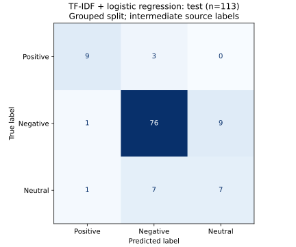

# Sentiment baseline and initial results

The baseline is TF-IDF plus class-balanced logistic regression, using Tia's shared grouped split and the proposal's Mixed-to-Neutral mapping. Results measure agreement with the **accepted intermediate source labels**, not independent human-gold performance or the original paper's final benchmark.

## Reproduce

From a fresh clone, after fetching the pinned source into `data/raw/screen-source` as described in `annotations/README.md`, run:

```sh
python -m src.data.preprocess --source data/raw/screen-source --output data/processed/screen-reproduction --public results/data-reproduction
python -m src.sentiment.baseline --dataset data/processed/screen-reproduction/articles.jsonl --manifest results/data-reproduction/split_manifest.csv --preprocessing results/data-reproduction/preprocessing.json --output results/sentiment-reproduction --model results/models/tfidf-logreg-reproduction.joblib
python -m unittest discover -s tests -v
```

These commands use fresh output paths, so they work even when the committed reference results are present. The sentiment run verifies the dataset and split-manifest hashes, checks group separation, trains on 329 training records, and evaluates the fixed models on 110 validation and 110 test records. The 209 review-reserved records are excluded. Metrics, predictions, and confusion matrices go to `results/sentiment-reproduction/`; the serialized platform-aware pipeline goes to the ignored `results/models/` folder.

## Configuration

Both models use TF-IDF unigrams/bigrams, a 20,000-feature cap, minimum document frequency 2, and sublinear term frequency. No stop-word list is used, preserving negation. Vocabulary and IDF are learned from training texts only. Logistic regression uses C=1, balanced class weights, the lbfgs solver, a 2,000-iteration limit, and seed 584. The fit converged in 19 iterations. The platform-aware model prepends a `platform_youtube` or `platform_snapchat` token. This is appropriate because labels describe platform-specific framing; the paired examples below preserve differing source labels. These settings were fixed, with no validation/test search and no refit on validation.

Training labels are 251 Negative, 45 Neutral, and 33 Positive. Balanced class weights reduce the dominance of Negative during fitting. A training-majority classifier is included as the reference baseline, rather than comparing only against a raw corpus percentage. Probability outputs are uncalibrated and should not be described as reliable confidence estimates.

## Results

| Split / model | n | Accuracy | Macro precision | Macro recall | Macro-F1 |
| --- | ---: | ---: | ---: | ---: | ---: |
| Validation / text-only logistic regression | 110 | 0.8273 | 0.6886 | 0.7076 | 0.6976 |
| Validation / platform-aware logistic regression | 110 | 0.8273 | 0.6886 | 0.7076 | 0.6976 |
| Validation / majority | 110 | 0.7636 | 0.2545 | 0.3333 | 0.2887 |
| Test / text-only logistic regression | 110 | 0.8636 | 0.7962 | 0.8675 | 0.8248 |
| Test / platform-aware logistic regression | 110 | 0.8636 | 0.7962 | 0.8675 | 0.8248 |
| Test / majority | 110 | 0.7636 | 0.2545 | 0.3333 | 0.2887 |

| Test class | Support | Precision | Recall | F1 |
| --- | ---: | ---: | ---: | ---: |
| Positive | 11 | 0.9167 | 1.0000 | 0.9565 |
| Negative | 84 | 0.9481 | 0.8690 | 0.9068 |
| Neutral, including Mixed | 15 | 0.5238 | 0.7333 | 0.6111 |

The platform token made no difference to aggregate scores on this split. Test accuracy is 10.00 percentage points above majority prediction, and macro-F1 is higher by 0.5361. These results still measure agreement with intermediate labels, not human-gold accuracy. Test support is small, especially for the minority classes, and does not establish statistical significance.



The largest error directions are Negative -> Neutral (10) and Neutral -> Negative (4). Of the 15 three-class Neutral test references, the exact source stance breakdown is in the prediction records; Neutral includes both original Neutral and Mixed labels. The split changed after the duplicate audit, so the earlier error examples and scores have been replaced.

As an illustrative case, the article identified by `snapchat|104|Meta, Snap, TikTok join forces to combat suicide and self-harm content` has a Mixed source label and is predicted Negative. It describes both harmful content and a coordinated safety response. A plausible explanation is that harm-related terms outweigh benefit/mitigation framing in this lexical baseline; this is an interpretation, not a verified attribution of the model's decision. The example was inspected after scoring and was not used to tune the baseline.

YouTube test accuracy is 0.7879 (n=66); Snapchat is 0.8511 (n=47). Per-platform macro scores in the JSON include all three classes with zero for undefined scores. Snapchat has no positive reference items, so its macro-F1 cannot be read as a comparison on equal class coverage. Always report support with these scores.

## Cross-platform duplicate review

Three exact text groups have different intermediate source labels across platforms: `snapchat|81` / `youtube|974` (Neutral / Negative, review-reserved), `snapchat|87` / `youtube|986` (Neutral / Negative, train), and `snapchat|88` / `youtube|987` (Neutral / Negative, train). The copies stay together within their shared split. Keep both source labels for a joint human review; do not relabel either copy from the article text alone. The model input includes platform because the target is platform-specific. On this run the platform token did not change the aggregate scores.

## Limits and next work

The source labels are intermediate consensus outputs, not new human annotations. The updated 0.85 five-word-shingle threshold catches the cited Arkansas copies and related review items, but remaining paraphrases could still make this easier than generalizing to a new event or future period. The benchmark is not a chronological holdout. Keep this test set fixed and avoid repeatedly adjusting settings after seeing its errors.

Pranav should review the label mapping, class weighting, confusion matrix, and error examples. Transformer comparisons remain outside this baseline contribution. Exact input hashes, package versions, run time, settings, and full class metrics are stored in `results/sentiment/metrics.json`.

Implementation references: scikit-learn [TfidfVectorizer](https://scikit-learn.org/stable/modules/generated/sklearn.feature_extraction.text.TfidfVectorizer.html) and [LogisticRegression](https://scikit-learn.org/stable/modules/generated/sklearn.linear_model.LogisticRegression.html).
