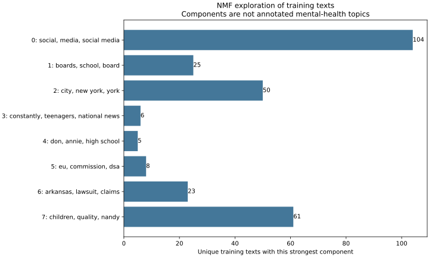

# Topic inventory, exploration, and annotation plan

The released CSVs have **no topic columns**. Their labels are accepted/provisional stance votes or relevance decisions. The source Stage 2 notebook defines a 12-topic vocabulary and describes generating topic outputs, but those outputs are not in the pinned release. A supervised multi-label baseline and topic F1 scores would therefore require labels we do not currently have.

This contribution takes the fallback specified in the task: preliminary topic exploration and a concrete annotation plan. The `src/topics/baseline.py` entry point runs that fallback and explicitly records unavailable supervised metrics as `null`.

## Reproduce

Install the requirements in Python 3.12 and obtain the pinned source clone at `data/raw/screen-source` as described in `annotations/README.md`. Run from the project root with fresh output directories:

```sh
python -m src.data.preprocess --source data/raw/screen-source --output data/processed/screen-reproduction --public results/data-reproduction
python -m src.topics.baseline --source data/raw/screen-source --dataset data/processed/screen-reproduction/articles.jsonl --preprocessing results/data-reproduction/preprocessing.json --output results/topics-reproduction
python -m src.topics.prepare_pilot --dataset data/processed/screen-reproduction/articles.jsonl --output data/processed/review_topics_pilot-reproduction
python -m unittest discover -s tests -v
```

These commands preserve the committed results and create a fresh local pilot packet. For another run, choose new empty directories for each output path and update `--dataset` and `--preprocessing` to match. Topic outputs go under `results/topics-reproduction/`; the packet and blank sheets go under the ignored `data/processed/review_topics_pilot-reproduction/` folder.

Source CSV inventory hashes normalize CRLF line endings to LF before SHA-256, matching the release audit convention. Generated dataset and split-manifest hashes remain hashes of their exact artifact bytes.

The topic command verifies the pinned source and dataset hash, audits all four released CSV schemas, and uses only training records. It collapses cross-platform exact-text copies for exploration, leaving **277 distinct training texts** from 329 article/platform training records. Those records occupy 227 distinct duplicate groups. Validation, test, and review-reserved texts are not used. The committed reference outputs are the inventory/configuration/components in `results/topics/exploration.json`, keyword candidates in `results/topics/keyword_candidates.jsonl`, and a component-count plot. Reproduction writes those same filenames into the fresh topic output directory.

## Vocabulary and label status

Use the exact 12 topic names in `src/llm/schema.py` and the definitions in `annotations/guidelines.md`: Anxiety; Depression; Suicide/Self-Harm; Bullying/Cyberbullying; Body Image/Eating Disorders; Addiction/Overuse; Sleep Disruption; Policy/Lawsuits/Bans; School/Education; Therapy/Access to Care; Stigma/Awareness; Parental Controls/Safety Features.

Each reviewed article may receive zero to three primary topics. A reviewed empty array differs from missing review. The proposal mentions substance use as an example, but it is not a released topic label or part of the source notebook's vocabulary; add it only through a documented schema revision and consistent annotation. The source notebook unions topic outputs from several models, which can exceed its individual three-topic cap. Imported outputs would need provenance and schema checks before comparison with our reviewed labels.

## Initial exploration

TF-IDF uses English stop words, unigrams/bigrams, minimum document frequency 2, maximum document frequency 0.95, and a 10,000-feature cap. Nonnegative matrix factorization (NMF) uses eight components, nndsvda initialization, seed 584, a 1,000-iteration limit, and tolerance 0.0001. The updated fit completed in 49 iterations. Eight components is a fixed exploratory setting, not a tuned number of mental-health topics. Reconstruction error is retained as a fitting diagnostic, not a classification score.

| Component | Selected terms | Texts with this strongest component |
| --- | --- | ---: |
| 0 | city, New York, lawsuit | 43 |
| 1 | school, boards, district | 31 |
| 2 | social, media, children | 114 |
| 3 | lawsuit, Arkansas, claims | 18 |
| 4 | constantly, teenagers, Pew | 6 |
| 5 | Annie, senior, high school | 9 |
| 6 | children, quality, content | 50 |
| 7 | cent, Caraway, media | 6 |

These are interpretations of component terms, not topic annotations. The components mix broad language, named events, and recurring syndicated stories. For example, school-board and city-lawsuit components suggest useful policy/education review candidates, while the Pew and advice-column components show that NMF can isolate a particular story family instead of a mental-health concept. The generic component and imperfectly coherent component 7 are further reasons not to map components automatically into the 12 labels.



A separate regex pass finds texts containing search cues for each proposed topic. The largest candidate counts are Policy/Lawsuits/Bans (171/277), School/Education (161/277), and Addiction/Overuse (143/277). The smallest include Sleep Disruption (24/277), Therapy/Access to Care (28/277), and Body Image/Eating Disorders (29/277). Counts overlap because a text can match multiple cues. They are **not topic prevalence**: a school mention can be incidental, a risk may be negated, and a relevant concept may use different wording. Candidate files must not be used as reference labels or shown to blinded diagnostic reviewers.

## Annotation and supervised-baseline plan

1. Keep the 12-topic vocabulary and zero-to-three cap under guidelines v1.1. Substance use stays outside this version. Check any later topic-bearing release for matching article IDs, text, and label provenance before using it.
2. Start with 40 training articles: 20 selected by seeded hash ordering and 20 selected round-robin from rarer keyword-candidate lists. Use one article per duplicate group and six separate practice groups. The reproducible `src/topics/prepare_pilot.py` command uses seed 584, the regenerated dataset hash, and distinct training groups; it writes blank reviewer sheets without source labels or candidate tags. Candidate enrichment improves review coverage; it does not measure prevalence or guarantee positive labels. The refreshed packet is local under `data/processed/review_topics_pilot/`.
3. Proposed roles are Shiven plus another available teammate as independent reviewers, with a third teammate adjudicating. Assignments remain unconfirmed. Discuss practice items, freeze the guidelines, then review the 40 pilot items independently without candidate tags, source labels, or model predictions. Record evidence and confidence. Measure topic agreement before adjudication and preserve both original sheets. The pilot checks feasibility; expand training annotation if support is insufficient.
4. Keep the existing grouped splits. Obtain independent topic reviews for all 110 validation and 110 test article/platform records under the frozen guidelines. Keep test labels out of development and use validation labels only for threshold selection. Preserve platform attribution when reviewing related records. Collin's diagnostic packet and related groups remain reserved and cannot enter training or few-shot examples. Completing that packet is a separate task, not a prerequisite for this training pilot.
5. Encode adjudicated topics in the fixed schema order. Missing review stays missing; a reviewed empty array becomes an all-zero target. Check positive and negative support per topic and partition. Fit TF-IDF and one-vs-rest logistic regression on labeled training items only. Report micro-F1, macro-F1, per-topic precision/recall/F1, support, and zero-division rules. Flag unsupported topics and expand annotation before claiming meaningful comparisons.
6. For the midterm, report the existing inventory and exploration. Human annotation and the supervised baseline remain pending. The local packet contains no completed reviews, and keywords and NMF components are not reference labels.

Shiven approved the topic definitions and annotation plan. Human annotation and supervised topic evaluation remain pending.

References: the pinned [SCREEN release and notebooks](https://github.com/LEAF-Lab-Stevens/SCREEN-Dataset/tree/246d3d365d5898f6fdf5240264215e49b082d743), and scikit-learn [NMF](https://scikit-learn.org/stable/modules/generated/sklearn.decomposition.NMF.html). NMF is used as a lightweight exploratory method here; the proposal's BERTopic and SetFit comparisons remain future work.
